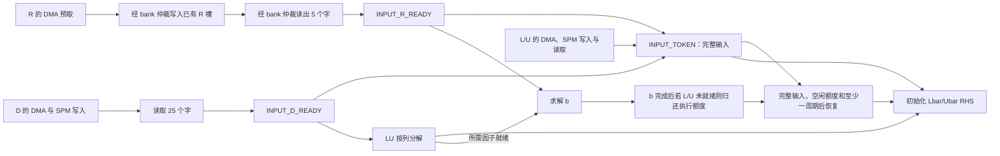

# 冷轮 R 提前供给与 RHS 分批就绪

本轮继续使用单线、5 MUL / 5 ADD-SUB / 1 DIV、4 个 bank 和 LU4/RHS4。
目的是解除 b 对完整 L/U 输入的等待，性能选择以整轮实测为准。
完整来源、运行参数和轨迹见[实验记录](/home/zyy/gem5/results/cfd_dsa/analysis/cold-rhs-opt-20261026/README.md)。

## 数据与执行顺序

新增 `--coeff-cold-rhs-prefetch=0|1`，缺省关闭，要求启用 D 提前读取、有限 RF 端口、
共享算术、按行 RHS、rhs-frontier、LU 因子转发及提前求解，并使用 direct 自主单线 DMA 模式。

输入路径仍按原顺序读取 D/U/L；R 从独立预取槽取得，原请求不再读第二份 R。
R 完成 DMA 还不算 ready：须等 SPM 写入完成，再等实际 5 字读取完成。
Lbar/Ubar 不允许使用尚未读出的矩阵。

`INPUT_TOKEN` 和 `inputDoneCycle` 的完整输入语义保持不变，新增 `INPUT_R_READY` 独立记录。
RHS 的每个 batch/column 只初始化一次；b 的提前计算不会重复启动整个求解请求。
单点线仅需 D/R：D 读取完成后不创建 0 字的“剩余矩阵读取”任务。

## 有界状态与硬件含义

复用原有最多 8 个 R 槽及其有限访问任务，数量受 lookahead 和请求窗口共同约束。
R 已进入原有请求寄存器后才释放槽位；不为冷轮再添加一组 R 数据阵列。
新增每请求的初始化掩码、挂起位和恢复周期状态，仍须满足 `Request <= 8192 B`、
`OnchipContext <= 128 B` 等编译期容量约束。

只允许完整 b 挂起，此时系数 RHS 未初始化，不能存在挂起中的 RHS 运算。
b 和 LU 保留在原本已预算的请求状态中；恢复重新取得原有 RHS 执行额度，不增加并行执行数量。
恢复至少间隔一个周期，仍受调度、RF 和算术资源限制。
实际 RTL 需要有效位、标签、完成计数和恢复选择逻辑；这里的容量上限不等同于综合面积和频率结果。

总 DMA 输入字节和 SPM 操作数字数应保持不变，但 R 从子请求 CoeffInput 统计转到父 line 的 rhs/cacheRead 统计。
调度改变可能改变 packet 合并，不能只比较某一项输入计数或把 packet 数当作字节数。
SPM 到请求寄存器沿用既有传输模型；算术 RF 端口模型没有据此变成经过 RTL 标定的统一 RF。

## 验证

新增检查器关联 R 的 DMA 响应、SPM 写/读、R token、RHS 初始化、算术发射、挂起/恢复和执行额度。
保留完整数据、独立数值 oracle、FP64 顺序、私有 LU、有限容量、bank/RF、取消恢复与归档验证。
既有 259 项单元测试保留，新增 16 项，共 275 项。
性能组固定 D 提前读取为 1，仅切换冷轮 R 开关，使用同一二进制和相同输入。

现有前沿状态采样仍优先按“完整输入未就绪”标记 `input_dma_spm`，期间可能已有 b 运算。
该采样不能解释为 b 的输入等待或全局空转；新机制的提前量以 R、RHS 初始化和 b 完成事件为准，
利用率以实际发射轨迹为准。

最终实测、默认选择与剩余瓶颈见[RESULTS.md](/home/zyy/gem5/results/cfd_dsa/analysis/cold-rhs-opt-20261026/RESULTS.md)。

## 实测与选择

22 例完整验收、5 组同二进制对照和 275 项测试通过。对照中保持 D 提前读取开启，
仅切换本轮冷 R 机制；所有组的输出 FNV64 一致。

| 输入 | 关闭周期 | 开启周期 | 周期减少 |
|---|---:|---:|---:|
| 65 点冷轮 | 7959 | 7945 | +0.1759% |
| 1024 点训练 | 161860 | 162182 | -0.1989% |
| 1024 点独立输入 | 160156 | 161014 | -0.5357% |
| 4096 点独立输入 | 750794 | 751792 | -0.1329% |

4096 点有 3800 个请求提前启动 b，1254 个在完整输入前完成并挂起；整轮仍慢 998 周期。
空发射周期从 118721 降至 114443，但 MUL 实际发射率从 38.7265% 降至 38.6751%。
因此减少空发射、提前启动和提高整轮吞吐是不同指标，不能互相替代。

默认保持关闭，不引入自动线长阈值。R-only 候选保留用于后续对照，下一步应联合准备 b/Lbar，
并评估有界乘积暂存与 SUB 旁路；具体尚未实现的设计见本轮记录中的 `NEXT_DESIGN.md`。
当前 95% 利用率目标尚未实现。
