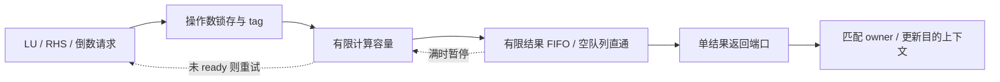

# CFD 共享 FP64 除法器的 gem5 建模

更新日期：2026-10-21。范围是 gem5 中的微体系结构与数值行为，参数不绑定具体器件。

## 已实现的模型

所有 LU 标量除法、RHS 直接除法和对角倒数生成经过 `issueDivide`。接收时锁存两个 FP64 位模式、唯一 tag 和外层请求 token；结果回调关联目的 RHS 或 LU 位置。未接收的请求保留在调用者上下文中重试，除法器前没有另设输入 FIFO。

细化模型包含计算部分和独立结果 FIFO，两者都有容量上限。计算部分用每笔 token 的剩余周期表示进度。结果 FIFO 空且返回接口可用时支持直通。每周期先处理返回与计算推进，再允许接收新请求，因此同周期可以释放槽位、接收下一笔。

结果 FIFO 满且最早的计算即将完成时，整个计算部分暂停：所有 token 的剩余周期和启动计数都保持不变，禁止新接收；结果接口仍可排空 FIFO。其他情况下 FIFO 有积压不一定立刻阻塞输入。

请求取消时保留在途 token，继续占用计算/FIFO/返回资源，排空后按 owner 丢弃结果。不能通过取消一项请求重置共享除法器。控制器每周期检查在途 token 数和未完成回调数一致，防止漏失信用；细化路径禁止绕过统一入口。



## 数值规则

细化模型使用 SoftFloat `f64_div`，固定最近舍入、居中取偶数，保留非正规数并在舍入后检测微小结果。结果包含 NV/DZ/OF/UF/NX 标志（位值分别为 16/8/4/2/1），NaN 规范化为 `0x7ff8000000000000`。调用前保存、调用后恢复 SoftFloat 全局舍入、微小值检测和异常状态，避免干扰 CPU 模型。

异常标志目前用于模型诊断，不自动生成 CPU 异常或新增软件可见寄存器。LU 的主元检测与失败策略继续由原有求解器控制。

数值函数在 token 完成时执行；宿主机函数运行时间不进入模拟延迟。没有模拟逐位求商、部分余数或具体电路流水级。迭代式选项表示单笔计算独占的时序约束。

## 配置与默认行为

单线入口在 `--coeff-compute-model=shared` 且只有一个共享除法器时，默认选择 `pipelined`。显式 `--coeff-divider-model=timing` 保留旧路径。独立旧计算簇及多除法器对照默认继续使用 timing；细化模型目前只支持单实例共享除法器。

| 参数 | 默认值 | 含义 |
|---|---:|---|
| `--coeff-divider-model` | 单实例共享单线为 pipelined；通用入口为 timing | timing / pipelined / iterative |
| `--coeff-cluster-div-lat` | 12 | 无停顿计算延迟 L |
| `--coeff-cluster-div-ii` | 4 | 启动间隔 II |
| `--coeff-divider-inflight` | 0 | 自动：流水式 ceil(L/II)，迭代式 1；显式可设 1..64 |
| `--coeff-divider-result-depth` | 2 | 结果 FIFO 深度，可设 1..16 |
| `--coeff-divider-writeback-ii` | 1 | 结果返回间隔，可设 1..64 |

细化模式的 L 和 II 范围为 1..4096。迭代式必须满足容量 1、II >= L，例如 L=12、II=12；默认 II=4 不能直接用于迭代式。上述周期数是架构实验参数。

若容量低于 ceil(L/II)，模型会因容量不足主动限流。三笔计算槽位并不表示三个除法器。计算槽位和结果 FIFO 的寄存器容量独立于 SPM；模拟器容器、回调及统计对象的 `sizeof` 不能充当 SPM 预算。

返回接口目前代表可配置的本地结果端口，ready 由返回间隔决定；尚未连接 SPM bank、目的寄存器 bank 或独立写回仲裁。LU/RHS 请求继续沿用控制器现有扫描和优先级，不额外改变全局调度。

## 统计与 trace

`CFD_DIVIDER_SUMMARY` 是控制器静止时的累计快照，读取最后一条，不能把多个快照相加。包含接收/产生/返回数、核心/FIFO 峰值和当前占用、流水暂停、输出等待、计算与结果等待的占用积分、总驻留周期、最大驻留周期、丢弃数和累计异常标志。

在完全排空后，应满足：

- accepted = produced = returned，core_live = result_live = 0；丢弃响应也计入 returned。
- core_occupancy = Σ(produced - accepted)。
- result_occupancy = Σ(returned - produced)。
- residence_cycles = core_occupancy + result_occupancy。
- 共享除法资源的 occupancy_sum = residence_cycles。

`coeff_preprocess_trace.csv.divider.csv` 记录接收与响应，含操作数、tag、owner、产生时间、响应时间、FP64 结果、异常、占用及丢弃标记。原 cluster CSV 的 complete_cycle 保留无停顿预测；分析程序对细化除法使用 divider CSV 的实际响应时间。

`check_divider_model.py` 独立重放接收序列、全局时钟使能、有限 FIFO 和结果返回端口，检查实际响应周期、操作数身份、数值、容量、取消丢弃及所有占用统计，并与 cluster 的除法接收记录交叉核对。数值重放用宿主 binary64 结果交叉检查；特殊值及异常标志另由 C++ 组件测试覆盖。

## 验证命令

```bash
python3 -m unittest discover -s projects/cfd_dsa/tests
LINKFLAGS_EXTRA=-Wl,--no-keep-memory scons build/ARM/gem5.opt -j4
python3 projects/cfd_dsa/tools/run_suite.py projects/cfd_dsa/suites/single-line-divider-model.json --campaign divider-model-rerun-01
```

专项套件覆盖直接/逆矩阵路径、边界尺寸、完整缓存复用、倒数复用、随机输入、版本与 dirty 变化、失败取消后恢复、迭代模式、容量 1、FIFO 深度 1 与返回间隔 16 的压力，以及 timing 对照。验证已完成：41 项单元测试、25/25 专项仿真与自动验收通过。默认流水式与 timing 对照的控制器周期均为 5,329；容量 1 对照为 13,619。直接求解结果端口压力用例累计计算暂停 16,334 周期，最长驻留 64 周期。两项取消恢复用例各排空并丢弃 3 笔在途结果。性能与逐例证据见 `results/cfd_dsa/analysis/divider-model-20261021/REPORT.md`。
