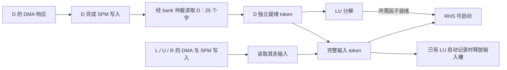

# 2026-10-26：D 独立就绪与 LU 提前启动

本次保持 5 MUL、5 ADD/SUB、1 DIV、4 个 SPM bank，改动输入依赖与生命周期管理。
实验和完整轨迹见 [本轮记录](/home/zyy/gem5/results/cfd_dsa/analysis/forward-input-opt-20261026/README.md)。

## 问题与机制

旧路径必须等 D、L、U、R 全部写入 SPM 并读出，才发布统一输入 token、启动 LU。
先前 1024 点轨迹中，最后一个 D 写响应到统一输入 token 的间隔中位数为 78 周期，P95 为 324 周期。
该间隔还包含资源竞争，不能将各请求的间隔直接相加当作可节省时间。

新增 `--coeff-input-d-early=0|1`，缺省为 0。开启后，仅对含其他输入的原始 D 冷轮请求拆分读取：

D 必须完成全部 200 B 的 SPM 写入，才允许独立读任务入队；LU 必须等待该读任务完成。
L/U/R 的 DMA、片上写入和读出继续推进，计算 stage 的变化不会阻止输入状态机。
RHS 仍等待完整输入；输入槽在剩余数据搬运和读取完成之前不能被复用。
若 LU 上下文仍满，D 提前就绪不会绕过上下文限制。

`inputDoneCycle` 和 `INPUT_TOKEN` 仍表示完整输入就绪，没有改成 D 就绪。
开启后 `luIssueCycle` 可以早于 `inputDoneCycle`；分析 LU 排队时应以 `INPUT_D_READY` 为依赖起点，
不能把两者之差为负解释为记录错误。输入活动周期与 LU 活动周期可以重叠，不能直接相加。

系数缓存命中、软件已经分解好的 LU 输入、没有其余输入的 D 单独请求保持原路径。
没有改变 LU/RHS 的算术顺序，也没有引入算术旁路。

## 有界成本与硬件含义

原来的一个输入读取任务拆成 D 和其余输入两个不重叠任务，总读取字数和输入 DMA 分包规则不变。
调度时机变化会影响原有输出合包，总 packet 数仍可能变化；比较时分别记录数据字节量和 packet 数。
每个冷请求多一个访问任务，使用原有有限访问队列、仲裁延迟和 bank 端口。
一个 D 读任务引用、16 位完成字节计数和两个就绪位放在原有访问上下文与请求状态预约内；
编译时保留 `OnchipContext <= 128 B` 和 `Request <= 8192 B` 等约束。
192 KiB 功能组保持原预约不变，不通过增大容量隐藏开销。

这些是有界容量约束，不是综合面积结果。实际硬件需要 D 完成计数/scoreboard、加载任务标签和独立有效位。
选择逻辑与布线仍需硬件标定。RF 的 16R/8W 带宽计数目前仅覆盖算术读写，
SPM 到输入寄存器的加载沿用已有独立传输模型；尚未证明它与算术写回能共享同一组物理 RF 写端口。

## 验证口径

新增输入依赖检查器把真实 packet 响应、SPM 读任务、D token、LU/RHS 发射和输入槽释放逐项关联。
检查读取区域恰好覆盖 D 和其余输入且不重叠，拒绝提前消费、重复 token、错误 owner/标签和槽位覆盖。
取消恢复另行检查已经开始的 D 读取和 line 终止时的资源排空。

同一二进制、同一输入和相同资源做开关对照。主性能组关闭上一轮的独立后向就绪和 Tile 顺序开关，
避免把多个机制的结果混在一起。原有 247 项测试保留，增加 12 项输入依赖检查，共 259 项。
性能结论以整轮周期、空发射周期和实际发射利用率为准，提前启动次数只用于解释原因。

## 实测与选择

18 例完整验收和 5 组同二进制对照通过，所有对照的输出 FNV64 签名一致。

| 输入 | 关闭周期 | 开启周期 | 周期减少 |
|---|---:|---:|---:|
| 1024 点训练 | 162670 | 161860 | 0.4979% |
| 1024 点独立输入 | 161008 | 160156 | 0.5292% |
| 4096 点独立输入 | 750893 | 750794 | 0.0132% |

4096 点有 4011 个请求提前启动 LU，但整轮仅少 99 周期，长线实际收益很小。
默认保持关闭；该机制保留为独立实验开关，不新增自动线长阈值。
95% 发射利用率没有实现。下一步优先验证 R 独立供给、RHS 按批次就绪和有限局部乘积旁路，
继续保持算术单元数量不变并支付实际控制、端口和存储成本。

最终数值与选择见 [RESULTS.md](/home/zyy/gem5/results/cfd_dsa/analysis/forward-input-opt-20261026/RESULTS.md)。
