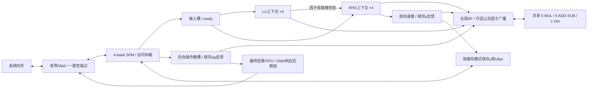
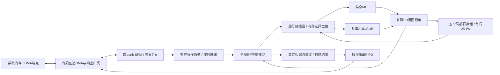

# 单线广播、逐行调度与局部数据通路设计

本设计保持单条网格线和四个 SPM bank。主对照共享五个 MUL、五个 ADD/SUB、一个 DIV；上下文不会复制算术单元。本文区分已实现的 gem5 资源契约、消融实验和仍需外部证据的物理标定。最终实测结果见分析目录的 RESULTS.md。

本轮可用优化首先是 `--coeff-preprocess-broadcast=1`：同一次 LU/RHS 前向更新的多个乘法共享一个因子时，只读一次公共操作数。逐行调度、局部寄存器及更深操作数预取作为独立研究开关，兼容默认值均不变；是否选入性能配置由同输入、同二进制的完整对照决定。

## LU/RHS 公共操作数广播

LU 的 lower 更新为 `LU[target,k] * LU[k,c]`，upper 更新为 `LU[c,k] * LU[k,target]`；RHS 前向更新为 `LU[row,k] * rhs[k]`。每个同周期乘法组有一个公共因子和若干各不相同的操作数。开启广播后，宽度 w 的组实际消耗 w+1 个全局 RF 读字，而不是 2w 个；仍消耗 w 个 MUL lane，结果仍逐一经过有限 FU 返回额度和 RF 写端口。

在发射时锁存公共因子与各操作数，保留原乘法操作数顺序及 FP64 舍入。RHS 后向更新的两个操作数都变化，不能套用这一广播。每个5×5 LU 有9个可广播组、节省14次 RF 读；每个5维 RHS 求解有3个组、节省6次 RF 读。冷轮 direct、边界省略 L/U 的 N 点测试实际有 `11N-10` 次 RHS 求解，因此1024点节省81860个64位读字；不减少全局写次数、算术工作量或系统内存 DMA 字节。

该开关要求启用已有 RF 广播通路、有限 RF 带宽、共享算术池及 RHS 行并行组织。不增加持久操作数槽；复用已有 MUL 输入广播/选择网络。网络扇出、选择器面积和时序并没有综合标定，现有 MUL 延迟不自动增加。延迟敏感性实验必须与同延迟的关闭广播对照比较，不能将网络扩展解释为物理零成本。

独立检查器将 `CFD_PRE_BROADCAST` 与实际 RF 发射标识、请求代次、LU/RHS 计算完成数逐项关联；核对合法更新方向、公共因子、组宽、读字和组数，拒绝对任意乘法错误地少计端口。广播后的最终结果哈希应与关闭广播完全一致。

## 数据通路

主路径保持上下文与共享算术分离，广播是可选开关；不能因短线受益就统一应用到长线：

完整系数缓存命中并满足本轮提交、版本与生命周期条件时，Tile只存y，后向Ubar来自系数缓存；长线完整缓存放不下时，Tile仍需y+Ubar backing。广播不改变这一存储模式。

以下是可选逐行/局部通路的内部结构，不是推荐配置默认新增的另一套算术池：

图中局部五个行存储服务五个未知量，与四个 SPM bank 是不同层级。局部存储端口属于新增资源，不能据此宣称完全没有额外硬件。

## 已实现的有限资源

`--coeff-lane-mvm=1` 将已有线 MVM 树拆为逐行操作。每个上下文有五列乘积、四个普通归约节点，后向带 y 的有符号树有五个归约节点；每个节点有五个独立行状态。三个上下文总共至多150个标量节点。一个行节点完成后，只唤醒依赖该行的消费者，不等待其余四行；最终向量和下一点递推仍必须满足全部五行以及原算法的相邻点依赖。

它覆盖线 MVM 及相应树归约，包括通过该接口运行的 warm direct 校正。LU/RHS 的现有行调度、冷轮前向列消费保留原组织；没有将全控制器声明为逐 lane 化，也没有跨点投机。

每个标量任务实际申请同一共享算术池的一个 lane。`--coeff-lane-issue-width=1..10` 限制本调度器跨三个上下文每周期的成功发射数；已就绪的深层消费者优先，乘积按列升序优先。LU/RHS 仍竞争同一组 FU 和全局 RF 端口。

`--coeff-lane-select-latency=1..16` 给操作数就绪至发射增加至少一个注册选择周期。`--coeff-lane-route-latency=1..16` 给中间结果从实际存储完成至可供选择增加至少一个转发周期。二者是独立的架构假设；不能把 C++ 遍历时间当作硬件延迟，也没有宣称仲裁树已在目标频率收敛。

`--coeff-lane-local=1` 可选开启五个共享局部行存储，每个每周期2读1写，跨三个上下文共同竞争。中间乘积和归约结果在实际取得局部写端口后发布；最终行结果仍消耗全局 RF 写端口。归约的普通两个输入从局部读取，后向首个 y-p0 节点消耗一个全局读和一个局部读。乘积仍消耗两个全局读：本版本没有把原向量标量广播自动推广为跨周期的免费标量锁存。

FU 返回额度保留到真实局部或全局写入完成；局部端口不足同样会背压。没有无限结果队列、零延迟旁路或免费丢弃中间结果。保持逐行 FP64 原有树结构，不改为 FMA，不更改误差门限。

逐行模式额外预约4096 B，包含三个固定上下文的新增就绪、时间和路由状态，以及局部存储/操作数/结果状态的保守空间。历史16 KiB控制预约不扣减。这个数值是容量契约，不能直接解释为综合后 SRAM 宏面积；端口、选择器、互连和动态能耗另需标定。

`--coeff-back-operand-depth=2..8` 将原来的两个后向 SPM→RF 操作数槽扩展为有界深度。每新增槽额外预约512 B，固定按 cell 对深度取模寻址；复用前必须完成此前槽的列读取和消费。它只提前读取操作数，不提前计算未知的邻点结果。Tile 预取、DMA在途数、SPM队列和bank端口限制仍生效。

## 验证与优化决策

独立检查器连接每个标量节点的 RF 物理标识、算术发射、真实存储完成、逐行依赖和 FP64 运算数值；检查选择/转发延迟、全部节点闭合、每点顺序及局部每行2R1W。传统 SPM逐word、DMA响应、容量、版本和最终数值检查继续执行。

逐项比较原实现、仅逐行、逐行加局部通路、增加操作数提前供给，然后在相同资源上比较5/5/1、6/5/1及新增MUL仅供LU。另测选择宽度与选择/转发延迟敏感性。只有整轮周期改善、容量成立、数值通过的配置进入推荐套件。

95%目标必须指明分母：整轮各FU有效发射率、阶段内发射率与任一算术单元活动率分别报告。MUL/ADD有效发射率为实际标量运算数/(lane数×整轮周期)，DIV按II折算吞吐占用；不是“有任意一个在途结果”的周期比例。启动、收尾、访存和依赖等待都保留。warm轮没有除法任务时允许DIV空闲。提高活动率但整轮更慢的配置不作为性能优化结论。

1024点冷轮有363220次MUL、312065次ADD/SUB、15360次DIV。共享5/5/1、DIV II=4，仅算术工作量给出至少72644周期；即使MUL100%发射，ADD/SUB也至多85.92%，DIV折算发射率至多84.58%。广播不减少RF写流量，690645个写字在8写/周期下仍至少需要86331周期。这个下界尚未加入单线反馈、访存、选择、写回与启动收尾，不能据此许诺95%。6/5/1的算术比例更平衡，但是否更快仍由实测决定。

## 物理标定边界

已有 FP64 延迟、II、RF聚合带宽、2GHz、DMA cache时序和DDR预设仍需IP/综合/存储宏或板级证据。新增逐行模型明确支付有限端口和注册级延迟，属于更具体的架构建模，不能替代RTL验证、布局布线或面积标定。队列申请/撤销带宽及LU/RHS选择网络仍需进一步建模。

旧向量路径的完整选择/互连延迟也未独立标定。本轮逐行路径增加显式注册级，所得负面结果只对当前两种时序契约成立，不能据此断言综合后的逐行结构一定更差。最终应在相同目标频率和完整路径成本下重新比较。

RF16R8W约束当前统计的是算术操作数读取和算术结果返回；SPM访问/落地另由片上模型约束。它不等于已经证明某一个物理RF同时提供全部算术与SPM装载端口。映射到硬件时，必须说明分布式上下文寄存器、操作数缓冲和结果RF之间是否独立，分别支付装载端口、容量、地址/标签和选择网络成本；如果合并为一块RF，还要将搬运端口流量并入竞争。当前不能据此声称完整物理RF流量已经标定。
