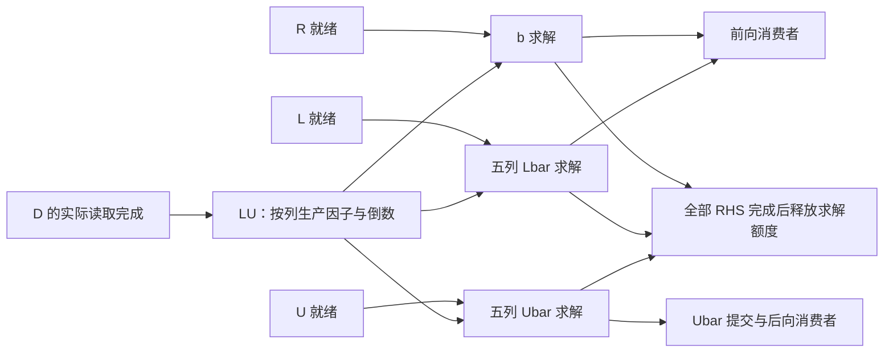

# LU 与 RHS 预处理加速方案（第三轮之后，2026-10-28）

本方案集中优化冷轮预处理：D 输入、LU 因子/倒数生产、多 RHS 求解、局部状态、RF、调度与结果交接。
采用第三轮已验收的 10 MUL / 10 ADD-SUB / 1 DIV、LU4/RHS4、RF 16R/8W 配置为参照。
1024 点已选配方开启预处理广播，4096 点配方关闭预处理广播；两者都使用局部 LU/RHS 乘积。
跨规模数据用于定位结构问题，不作为只改变线长的严格消融。本文件是方案，没有实现或验证下述新硬件。

## 当前工作量与数据依赖

每个内部 cell 先做 5×5 Crout LU，U 因子的对角线为 1，再求解一个 b、五列 Lbar、五列 Ubar。
即 `D = L_factor × U_factor`，`D × [b, Lbar, Ubar] = [R, L, U]`，共 11 个 RHS。
首尾各省去五个边界 RHS，因此 N 点冷线实际为 `11N−10` 个 RHS；N=1 时只有 b。

| 每个内部 cell 的工作 | MUL | ADD/SUB | DIV |
|---|---:|---:|---:|
| LU 分解、上三角归一化及五个共享倒数 | 40 | 30 | 5 |
| 单个 RHS | 25 | 20 | 0 |
| 11 个 RHS | 275 | 220 | 0 |
| LU＋RHS 合计 | 315 | 250 | 5 |

这是当前代码与物理发射日志相互核对的工作量，未把前后向扫描 MVM 计入 RHS。
1024 点预处理合计 322310 MUL、255800 ADD/SUB、5120 DIV；
4096 点为 1289990 MUL、1023800 ADD/SUB、20480 DIV。
RHS 占预处理标量浮点操作数约 86.8%，这个比例不是执行时间占比。

当前已经具备：D 独立就绪、LU 按行并行、LU 因子转发与提前启动 RHS、每点五个倒数共享、
按行 RHS 更新、32 个 RHS 乘积槽、局部乘积存储、拆分 RF 写回、关键 b/Lbar 排序、下一点 LU 供给。
不能把这些已有机制重新算成新方案。冷 R 独立预取、冷 RHS 树、第二轮双 RHS 配对目前都关闭。

## 本次重新统计的证据

分析器按真实 RF caller 分离 LU、RHS 和扫描 MVM；核对全部算术工作、RF 读写总量、
完整解压日志摘要及每个请求的生命周期。应用源码 192 个文件仍与第三轮冻结版本一致。

| 指标 | 1024 点 | 4096 点 |
|---|---:|---:|
| LU＋RHS 的 RF 读取字数 | 828800 | 3644740 |
| 占整轮 RF 读取比例 | 82.66% | 83.96% |
| 其中 RHS 读取字数 | 720256 | 3153220 |
| LU 发射到 LU_COMPLETE，平均周期 | 221.68 | 215.12 |
| RHS 启动到 b 完成，平均周期 | 210.42 | 156.22 |
| RHS 启动到全部 RHS 完成，平均周期 | 228.89 | 185.36 |
| b 完成后其余 RHS 的平均尾部时间 | 18.47 | 29.14 |
| 最后完成的 RHS batch 是 Ubar 的请求数 | 1023/1024 | 4095/4096 |

这些请求区间相互重叠，不能相加为整线停顿。较晚启动 RHS 会把部分 LU 等待移到启动之前，
所以 4096 点的 b 区间较短并不代表其整轮更快。LU_COMPLETE 也不等于最后一个倒数已返回：
末列倒数仍可能在途，必须检查真实 reciprocalReady 与消费者发射。

两组配置每个 RHS 分别读取 64／70 个 RF 字，每次 LU 为 106／120 个字；差异来自已选配方中
预处理广播的开关，不能归因于线长。广播已减少单次发射内的重复读取，跨 RHS 的时间复用仍有空间。

在当前访问方式下，仅 LU/RHS 的算术 RF 读取就需要至少 51800／227797 周期；
相应 MUL 的 10 路吞吐下界为 32231／128999 周期。这些是可重叠资源约束，取最大值，不能相加；
也不包含依赖、输入、控制及扫描 MVM 的竞争，不能直接当作可达到的加速比。
因此先处理依赖和重复操作数，再依据真实关键路径判断是否需要增加算术单元或 RF 端口。
若扩大 RF/局部 bank，必须同步计入多端口、选择网络、布线与访问时序，不能只提高配置中的带宽。

### 返回延迟的必要区分

1024 点 RHS MUL 的“实际返回减标称返回”合计 109043 个操作周期，其中 90032 是已有局部发布
一拍的累计值，其余为 19011。4096 点对应 406277 = 360368 + 45909。
这些是多个操作的重叠延迟总和，不能当作整轮损失，更不能全部归因于 RF 写口。

每个 RHS 当前最短依赖链为：前代四步各 `归一化 MUL3 + 行乘积(3+1) + SUB4`，末行归一化 3 周期，
回代四步各 `乘积(3+1) + m×SUB4`，m=1、2、3、4，合计 `47+56=103` 周期。
两组日志中 b 的最短实际区间均为 103 周期，支持这一条件下界。树形归约、旁路或改变组件延迟后需重新推导。

## 逐项优化设计

### 1. LU 乘积提前计算，累加保持原顺序：首批候选

当前 `processLuRows` 用一个 `luWaiting`、一份乘积向量和单一 phase，在同一 k 上执行
`MUL → 局部发布 → SUB → k+1`。当前列中不同 k 的乘积只依赖已完成的前面各列因子，
不依赖当前累加器，因此可以在 SUB(k) 期间先计算 MUL(k+1)。

设计采用两个交替乘积槽，分别跟踪 k、owner、generation、真实返回及消费状态。
SUB 必须严格按原 k 顺序执行；每次仍先舍入乘积，再做原来的减法，不引入 FMA 或重新结合。
产品槽只在消费者捕获操作数后复用；FU/返回信用仍按真实归还规则处理。

四项点积的现有理想依赖段为 `4×(3+1+4)=32` 周期；两槽充分供给时，依赖段可变为
`(3+1)+4×4=20` 周期。这个例子是段内调度机会，不是 LU 或整轮的已测收益。

额外有效载荷下限为每个 LU 上下文一个五字乘积槽，即 LU4 共 160 B；还必须计入端口、
标签、发布寄存与选择控制。现有 `luVisitedCycle` 每周期访问保护也需改成明确的 MUL/SUB 发射额度，
不能通过重复调用状态机获得无界额外发射。

主要代码：[LU 按行路径](/home/zyy/gem5/src/arch/arm/cfd_coeff_preprocess_lu_rows.inc)、
[FU 与回写](/home/zyy/gem5/src/arch/arm/cfd_coeff_preprocess_controller.cc:3580)。

### 2. LU 下三角与上三角分子重叠：第二批候选

同一列 c 的下三角更新和上三角分子点积，都只读取此前列的已知因子。
上三角的最终归一化才需要当前主元倒数。当前共享 `luTemps/luProducts` 及单一状态机将两者串行化。

可增加有界上三角累加/乘积状态，使其在下三角更新期间利用剩余资源；下三角主元路径和当前关键 RHS
保留优先权。c=1 时两组宽度分别为 4、3，算术数量上可容纳于 10 路 MUL/ADD，
但实际是否能同拍发射还必须通过 RF、局部 bank、结果信用和消费者就绪检查。

单独实现时，上三角额外累加器与乘积各五字，LU4 的有效载荷下限为 320 B。
与双槽预计算组合时需重新计算槽数和端口，不简单相加两项独立实验收益。

### 3. 压缩 LU 控制空拍，同时保留真实主元检查

当前 StartLower、StoreLower、PivotCheck、StartUpper、StoreUpper、NextColumn 等状态各消耗访问机会。
可以把纯索引更新、目的寄存器选择、下一阶段准备与前一操作返回衔接，减少不必要的行政状态。

主元有限性、epsilon 检查、倒数请求接受及 ready 发布仍是有依赖的工作，不能全部改成零周期。
优先将结果直接写入其最终所属的有限状态，减少仅为复制数组而存在的中间控制跳转；
明确比较、旁路和发布寄存的时序后，再评价因子真正提前了多少周期。
共享倒数已经把每点除法降为五次，不能再将它列为新增优化。当前两组 LU DIV 的实际返回延迟均为零，
没有输出侧排队证据；但 DIV 自身的 12 周期仍可能处于第一步或末步依赖链中。
先测每个倒数是否阻塞消费者、能否提前发射或与分子计算重叠，再决定是否值得调整除法器。

### 4. 因子跨时间保留，避免强制双 RHS 同步：首批候选

第二轮只让同时就绪的两列 Ubar 共读 LU，收益没有稳定落在关键路径上。
新方案改为少量因子保持槽：以 `请求、generation、前/回代、k` 标识一个已就绪 LU 向量或倒数，
装载一次后供随后多个 RHS 消费，不要求它们同周期到齐。

第一版只做当前前沿请求优先的两个因子向量槽。命中时通过有限局部读口供给，
未命中时允许关键 b/Lbar 走原 RF 路径；保留原算术操作数顺序。
装载必须支付 RF 读取，发布、比较与扇出必须有时序；槽位引用和替换必须受标签保护。
两份最多四字因子向量的有效载荷下限为 64 B，完整成本还含倒数/身份、端口和控制。
实现前先按真实消费者轨迹统计因子复用间距、跨请求交错、两个槽的预计命中与驱逐，
以关键 b/Lbar 的实际复用机会判断是否进入实验；不预设两个槽足以覆盖全部 RHS。

后续才考虑两到三个消费者的有界微块发射，规模依据 `RHS 数×行宽`、RF 读取、产品槽和 FU 信用决定。
不等待填满批次；关键 RHS 独立可发射。不能将 eleven-RHS 宽广播视为免费的多端口结构。

### 5. 热 RHS 行状态与乘积旁路：第二批重点

当前乘积已经局部保存，但 RHS 累加值、归一化结果仍重复访问全局 RF。
先选择 b 和当前待消费 Lbar 列作为两个热 RHS，探索将五字状态映射到有限局部 bank。
若保留副本，必须建模装载、写回与版本一致性；若原地重映射已有状态，仍需支付新的端口与选择成本。
两个五字状态的有效载荷为 80 B，不代表完整硬件只需 80 B。

乘积旁路只对可立即消费的关键操作生效。当前每 RHS 的八组行乘积都支付一拍局部发布。
只有在明确的实现中把这拍与已有 FU 输出寄存衔接、仍满足读写/扇出/捕获时序，才可能缩短依赖链；
不能仅将 localRouteLatency 改为 0。若新局部状态也给每次依赖更新增加一拍，节省的 RF 流量可能被抵消。

### 6. RHS 行级完成与关键写回：避免整组完成屏障

当前前代 SUB 一次更新 k+1 之后的多个行，`rhs.waiting` 只有在整组实际返回后才清零。
下一步最先需要行 k+1；更远行可以稍晚，但每一行内部仍必须完成前一个 k 的更新。

可给每行维护已完成步数与在途标记，行 k+1 真实返回后允许其归一化，其他行继续受原依赖保护。
现有 RF 已支持按 lane 拆分写回，因此新增点是“部分完成对消费者可见”，不是重复实现拆分端口。
需要把每行结果与 `request/generation/RHS/k/row` 绑定，不能只凭组级 callback 猜测行结果。

回写现在按标称完成时间排序。可测试有界的关键结果优先及年龄兜底，让当前 b/Lbar 的下一依赖更早返回。
必须保留全部写带宽和 FU 返回容量约束；被推迟的后台 Ubar 不能无限期占用槽位。

### 7. LU 与 RHS 联合仲裁：解决跨模块的优先级

RHS 内部已对当前 b/Lbar 排序，但 `processTick` 先调用 LU 及下一点 LU，再调用 RHS。
因此 RHS 的内部优先级不能保证它在共享 RF/FU 上一定先于 LU 获得额度。

建议用依赖需求选择供给：关键 RHS 可立即执行时，优先保障其必要读取/返回；
关键 RHS 被某一步 LU/倒数阻塞时，优先生产对应因子；无关键可执行工作时再推进下一点和后台列。
Ubar 保留年龄或有限最低进展保证，避免全部求解额度被未完成 Ubar 占住。

第一版限制候选数及级数，明确一次选择的寄存延迟；新增复杂排序不能默认零延迟。
要与已有 lookahead=1、supply-first 逐项对照，不将简单打开已有开关当作新联合调度。

### 8. 输入按实际 RHS 消费需求就绪

D 已能提前启动 LU，但当前冷 R 方案关闭，正常 RHS 仍等待完整输入。
此前只提前 R 虽让很多 b 更早启动，却未稳定缩短整轮；接下来应联合考虑 b 和最先需要的 Lbar 列。

保留真实 DMA/SPM 写入与读取完成条件，逐区域或逐列发布输入就绪。
L 是行主序时，一列的五个字并非连续 40 B，必须以真实包覆盖和 bank 读取证明整列可用，
不能将列标记提前视为数据已装载。还应核查提前初始化是否挤占四个求解上下文或长期占用输入槽。

### 9. Ubar 尾部、求解额度与请求保存分别处理

几乎所有非尾 cell 的最后一个 batch 都是 Ubar，b 后面还有平均 18.47／29.14 周期 RHS 尾部。
因此完全压制 Ubar 会妨碍下一请求取得求解额度，关键优先必须配合后台进展保证。

RHS 完成后，请求对象平均还保留 449.21／519.92 周期，但 `solveDone` 已使其不计入活跃求解额度。
该保存时间涉及数据提交/记录等，不等于 RHS 上下文被占用同样长的时间。
优化资源复用前必须分别统计 LU 执行额度、RHS 执行额度、产品槽、请求状态和提交记录；
不能依据请求仍存在就盲目增大 LU4/RHS4。

### 10. 数值图变化作为单独分支

现有冷 RHS 树开关可把四项顺序减法的 16 周期变为 12、三项的 12 变为 8；
单个 RHS 在理想供给下可减少 8 个回代依赖周期，但改变浮点结合顺序。
历史实验存在负面交互，不能直接全开。若开展，顺序应为 b-only、b+Lbar、最后才是 all。

FMA 或重新组织 LU 点积也属于不同数值图，不与保持 FP64 顺序的调度实验混用。
保留原数值误差门限、主元检查和独立参考；发生数值失败不得通过放宽门限取得“加速”。

已有 inverse 模式和系数缓存也应保留为独立算法对照。显式求逆需要额外构造与保存逆矩阵，
冷轮是否划算不能只比较后续矩阵向量乘的并行度；跨轮复用还依赖真实的系数更新间隔及版本校验。
本轮不假定 D/L/U 多轮不变，也不把历史 inverse/warm 收益算成当前 LU/RHS 冷预处理的新收益。

## 建议实施顺序与验收目标

| 阶段 | 改动 | 主要判据 |
|---|---|---|
| A | 增加 LU/RHS 行级实际返回和消费者身份关联；建立小矩阵纯预处理基线 | 观测开关不改周期；计数与现有物理轨迹一致 |
| B1 | LU 双乘积槽，SUB 顺序保持 | 各步因子实际就绪和关键 b 完成提前；无额外浮点操作 |
| B2 | 两项因子保持，独立于 B1 验证 | 关键 RHS 命中与读端等待改善；不等待拼组 |
| C | 热 RHS 状态/旁路、行级就绪或关键回写，各自消融 | 103 周期依赖链中的哪一段缩短、真实发布代价是多少 |
| D | LU 下/上三角重叠及联合仲裁 | 更快因子供给确实改善 b/Lbar 与整线吞吐 |
| E | 输入分批就绪、Ubar 尾部与容量配平 | 提前启动变为实际完成收益，无上下文或缓存退化 |
| 独立数值分支 | b-only／b+Lbar 树等 | 原误差门限与数值稳健性通过后单列性能 |

A 阶段补齐的身份为 request、generation、RHS、phase、k、row，以及名义完成、实际写入/发布、
消费者发射；尤其区分“前沿请求中的背景列”和“确实阻塞 b/Lbar 的操作”。
用依赖图中的最长前驱确定延迟，不能把各请求或各资源的重叠等待相加。

微基准测独立 D＋11 RHS 的延迟/稳态吞吐与 LU4/RHS4 并发；整线再测训练1024、另一组1024、
4096、边界、冷热缓存及取消恢复。不能把微基准收益直接当作整线收益。
同图方案要求算术次数、运算顺序、结果哈希一致，且维持有限 RF/bank/FU、槽位身份与实际回写约束。
新硬件必须记账：当前长线剩余 2496 B，72 点缓存配方仅余 512 B。
关闭冷轮软件功能不会自动消除固定硬件面积；需要实际复用既有存储或明确不同的静态配置。

首批建议采用 B1 和 B2 两个独立实现，再决定是否组合。两者分别缩短因子生产链、减少重复因子读取，
保持原浮点顺序；更复杂的行级就绪、旁路与联合仲裁在这些对照之后推进。
目前不承诺整轮百分比收益：需要实际注册延迟、有限端口和消费者关键路径的测量。

## 证据与代码入口

- [本次 LU/RHS 量化统计](/home/zyy/gem5/results/cfd_dsa/analysis/lu-rhs-plan-20261028/analysis.json)
- [可复核分析器](/home/zyy/gem5/results/cfd_dsa/analysis/lu-rhs-plan-20261028/analyze.py)
- [LU 按行实现](/home/zyy/gem5/src/arch/arm/cfd_coeff_preprocess_lu_rows.inc)
- [RHS 按行与产品槽](/home/zyy/gem5/src/arch/arm/cfd_coeff_preprocess_rhs_rows.inc)
- [局部端口与标签](/home/zyy/gem5/src/arch/arm/cfd_local_vector.hh)
- [第二轮公共因子配对结果](/home/zyy/gem5/projects/cfd_dsa/docs/CFD_DSA_ROUND2_RHS_PAIR_20261028.md)
- [冷 R 供给的历史结果](/home/zyy/gem5/projects/cfd_dsa/docs/CFD_DSA_COLD_RHS_OPT_20261026.md)
