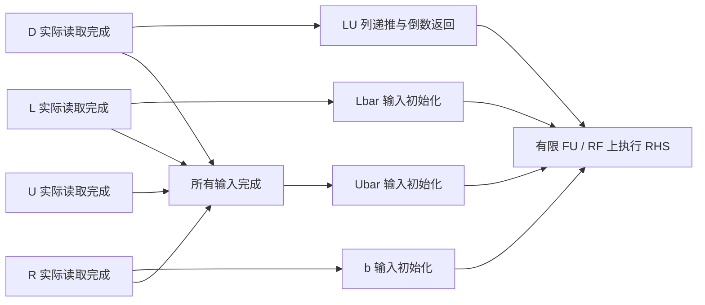

# 第七轮：按块发布输入，减少 LU／RHS 的整块等待（2026-10-30）

本轮已实现并验证 **D／L／U／R 分块就绪发布**。在两组固定 4096 输入上，仅开启分块发布、保留原 D→U→L→R 顺序，整线分别节省 **496／1111 周期（0.077623%／0.173557%）**，前向末点分别提前 **633／1300 周期**。这是小幅流水收益，不能解释为 LU 算术或关键 b 的普遍加速。

1024 的两组输入均未获得共同正收益，因此继续使用第六轮配置，精确保持 127195／127048 周期。65／71／72 的原有完整系数缓存与配方继续保留；17 单元测试选择 L-first，1916→1886 周期。配置选择由复现套件明确指定，没有按 N 自动切换的隐藏策略。

## 结果与采用范围

| 输入 | 同二进制对照／周期 | 采用配置／周期 | 节省周期 | 耗时降低 | 采用方式 |
| --- | ---: | ---: | ---: | ---: | --- |
| 主输入 s307／4096 | 638987 | 638491 | 496 | 0.077623% | batch=1，L-first=0 |
| 独立输入 s211／4096 | 640135 | 639024 | 1111 | 0.173557% | batch=1，L-first=0 |
| 训练 1024 | 127195 | 127195 | 0 | 0 | 保留 batch=0 |
| 独立 s307／1024 | 127048 | 127048 | 0 | 0 | 保留 batch=0 |
| 17 单元边界 | 1916 | 1886 | 30 | 1.565762% | batch=1，L-first=1 |
| 65／71／72 冷轮+两次热轮 | 12822／13963／14166 | 12822／13963／14166 | 0 | 0 | 保留完整缓存与原配方 |

2 GHz 下，两组 4096 的控制器耗时分别由 319.4935→319.2455 μs、320.0675→319.5120 μs。采用配置没有改变算术次序；同输入配对的输出哈希与标量 MUL／ADD／DIV 数量完全相同。这里的“独立输入”是不同固定数据的复核，不宣称对所有矩阵都能提速。

每个配对只允许两个新输入开关变化。1024 沿用 cold-R-prefetch=1、LU-control-fold=1；4096 沿用二者为 0；两者均为 Tile24 和原有 8 槽因子保持。因此跨规模数字不是只改变 N 的消融，性能结论以上表各组自己的对照为准。

## 实际修改

1. **块级输入发布。** 保留 D 的既有独立读取。其余每块在自己的实际 DMA／SPM 写入完成后，才通过有限 SPM 队列读取；等该次真实读取完成后才发布就绪。L 完成后允许 Lbar 初始化，R 完成后允许 b 初始化，输入落地槽仍保留到全部输入读取结束。

2. **有选择地提前使用 RHS 上下文。** 只有 b 或 L 已就绪才可触发提前求解；Ubar 继续等完整输入。沿用已有 rhs-frontier 调度和关键 b 优先级，避免仅有 U 的请求过早占用四个执行上下文。

3. **保留安全停放。** 冷轮预取 b 独自完成、其他 RHS 尚未初始化时，可释放执行上下文；L 实际就绪或全输入完成后，至少下一周期重新申请有限信用。没有将部分执行中的 RHS 隐式换出。训练 L-first 负消融完整覆盖了 30 次“全输入前恢复”的新路径。

4. **保留原始数据通路与有限资源。** 重用每请求已有的一个 rest-input 读取句柄，任意时刻最多一个此类读取。输入每个字只读一次；D 与剩余输入之间已有的独立句柄关系不变。按块切分会增加有限读取任务数，这些任务照常支付排队、bank／端口和实际返回延迟。

新增开关默认为 0：

```text
--coeff-input-batch-ready=1
--coeff-input-l-first=0
```

batch 需要已有 early-D、timed-SPM、shared、row-parallel、direct-b 路径；L-first 需要 batch。17 单元选 L-first=1，4096 选 0；1024 与短线热缓存用例保留 0。

块就绪只解除输入门控，RHS 算术仍要等待 LU 因子真实发布：



实现位置：[控制器与 RHS 初始化](/home/zyy/gem5/src/arch/arm/cfd_coeff_preprocess_controller.cc), [有限输入块读取](/home/zyy/gem5/src/arch/arm/cfd_coeff_preprocess_input_bursts.inc), [配置入口](/home/zyy/gem5/projects/cfd_dsa/configs/run_cfd_dsa.py), [独立存储／信用重放](/home/zyy/gem5/projects/cfd_dsa/tools/check_input_batch.py), [新增 11 项正反例](/home/zyy/gem5/projects/cfd_dsa/tests/memory/test_input_batch_ready.py)。

## 收益来自哪里

前沿状态按既有分类优先级逐周期互斥统计；其中 rhs_b_compute、lbar_correction 都包含依赖与发布等待，不能当作纯 FU 运算量。下面各项可与整线周期核对，但不能再与逐请求平均等待相加。

| 前沿状态／周期 | 主 4096 对照 | 主 4096 batch | s211 对照 | s211 batch |
| --- | ---: | ---: | ---: | ---: |
| 输入 DMA／SPM 等待 | 101508 | 104351 | 103193 | 106698 |
| b 的 LU 因子等待 | 34260 | 34937 | 34061 | 34837 |
| b 计算相关区间 | 244707 | 247515 | 245036 | 246560 |
| Lbar 修正相关区间 | 102128 | 95133 | 102157 | 94949 |
| 前向合并／发布 | 16458 | 16512 | 16461 | 16508 |
| 后向反馈 | 139195 | 139282 | 138562 | 138716 |
| 最终可见性 | 582 | 632 | 549 | 584 |

Lbar 修正前沿分别减少 6995／7208 周期，但输入等待、b 相关阶段和后向相位变化抵消了大部分收益。不能将这约 7000 周期全部计为整线加速，也不能从单点平均时间乘以 N 推算节省。

| 互斥整线分段的节省／周期 | 主 4096 | s211／4096 |
| --- | ---: | ---: |
| 启动 | 0 | 0 |
| 预处理／前向流水 | 633 | 1300 |
| 前后向切换 | 0 | 0 |
| 后向扫描 | -87 | -154 |
| 完成收尾 | -50 | -35 |

主输入是前向提前 633、后向多 87、收尾多 50，净节省 496；s211 是前向提前 1300、后向多 154、收尾多 35，净节省 1111。本轮没有修改后向算法，后向变化来自原有 Tile／DDR 与完成相位。

## 单点等待：区分初始化、驻留与真实返回

分块后，请求可能因 L 已到达而先进入 RHS，b 稍后才初始化。故 COEFF3_ISSUE→DIRECT_BASE_READY 不能直接称为 b 计算时间。以下 b 服务区间从其自身 RHS_INPUT_INIT 开始；独立分析将全部 RHS 逻辑发射与物理 RF id／宽度／owner／真实返回逐项对应。

| 平均周期 | 主对照 | 主 batch | s211 对照 | s211 batch |
| --- | ---: | ---: | ---: | ---: |
| RHS 请求总区间 | 167.576172 | 176.070068 | 167.425781 | 176.149170 |
| RHS 执行上下文驻留 | 167.576172 | 176.070068 | 167.425781 | 176.149170 |
| b 初始化前区间 | 0.000000 | 8.816162 | 0.000000 | 8.214111 |
| b 初始化后服务 | 150.834229 | 152.518555 | 150.163574 | 152.991211 |
| Lbar 初始化后服务 | 154.663980 | 159.831746 | 154.042247 | 160.231013 |
| 全输入就绪后剩余 RHS | 167.576172 | 167.253906 | 167.425781 | 167.935059 |
| LU 含倒数服务 | 214.000000 | 214.612549 | 213.981689 | 214.299316 |
| Lbar 初始化相对全输入的提前量 | -1.996337 | 6.620513 | -1.879853 | 6.500366 |
| Lbar 初始化的正提前量 | 0.000000 | 8.818315 | 0.000000 | 8.216117 |
| L 块就绪至 Lbar 初始化 | 1.996337 | 3.547253 | 1.879853 | 3.250305 |

lbar_input_lead_before_full 是“全输入完成 − Lbar 实际初始化”，负值表示初始化更晚；lbar_positive_init_lead 仅保留其中正值后按所有非边界点平均。b／Lbar 服务仍包含因子、RF、调度和实际返回等待，不是纯算术时间。

| b 自身服务的互斥拆解／平均周期 | 主对照 | 主 batch | s211 对照 | s211 batch |
| --- | ---: | ---: | ---: | ---: |
| LU／倒数等待 | 45.341553 | 47.093262 | 44.684570 | 47.604980 |
| 发射等待 | 0.850830 | 0.779541 | 0.833984 | 0.772949 |
| 算术固定延迟 | 95.000000 | 95.000000 | 95.000000 | 95.000000 |
| 返回／发布 | 9.641846 | 9.645752 | 9.645020 | 9.613281 |
| 完成标记 | 0.000000 | 0.000000 | 0.000000 | 0.000000 |

每组拆解精确相加等于 b 自身服务；其中 nominal_arithmetic 仍固定 95 周期，return_route 保留实际 RF 等待与局部产品一拍发布。本轮没有缩短共享倒数的 12 周期真实返回，也没有取消局部发布延迟。

| 提前推进／计数 | 主对照 | 主 batch | s211 对照 | s211 batch |
| --- | ---: | ---: | ---: | ---: |
| 全输入前启动 RHS | 0 | 3890 | 0 | 3902 |
| 全输入前初始化 Lbar | 0 | 3890 | 0 | 3902 |
| L 块提前就绪 | 0 | 4095 | 0 | 4095 |
| b 完成后停放 | 0 | 0 | 0 | 0 |
| 全输入前恢复 | 0 | 0 | 0 | 0 |

在所有非头点上，前向仍要同时等待 b 与 Lbar／上一点结果形成的修正。分块发布使部分 Lbar 提前推进，但未消除 LU 列递推和真实倒数门控；这解释了整线收益为何较小。

## 各阶段的起止、耗时与占比

以下时间从各用例的控制器描述符 DMA 发出计为 cycle 0；同时列出绝对原点。2 GHz 下 1 cycle=0.0005 μs。LU、RHS、前向、记录和输出存在重叠，**各阶段跨度占比不能相加**；上面的 sequential_partition 才是互斥分段。LU 含各点最后一次实际倒数就绪。

单点前向／后向只统计实际执行该阶段的点，边界跳过的运算不作为零时长点加入平均。

### 主 4096／对照

绝对原点 cycle 19576996，整线 638987 周期，319.493500 μs。

| 阶段 | 开始 cycle | 结束 cycle | 跨度 cycle | 起止／μs | 占整线 |
| --- | ---: | ---: | ---: | --- | ---: |
| 描述符 DMA | 0 | 107 | 107 | 0.0000–0.0535 | 0.0167% |
| 输入 | 108 | 499060 | 498952 | 0.0540–249.5300 | 78.0848% |
| LU 核心 | 558 | 498657 | 498099 | 0.2790–249.3285 | 77.9514% |
| LU 含倒数 | 558 | 498667 | 498109 | 0.2790–249.3335 | 77.9529% |
| RHS | 665 | 499173 | 498508 | 0.3325–249.5865 | 78.0154% |
| 前向 | 1098 | 499203 | 498105 | 0.5490–249.6015 | 77.9523% |
| 后向 | 499209 | 638404 | 139195 | 249.6045–319.2020 | 21.7837% |
| 最终输出 DMA | 499282 | 638709 | 139427 | 249.6410–319.3545 | 21.8200% |
| 记录／摘要 | 1158 | 502323 | 501165 | 0.5790–251.1615 | 78.4312% |
| 后向后收尾 | 638404 | 638987 | 583 | 319.2020–319.4935 | 0.0912% |

### 主 4096／batch

绝对原点 cycle 19576996，整线 638491 周期，319.245500 μs。

| 阶段 | 开始 cycle | 结束 cycle | 跨度 cycle | 起止／μs | 占整线 |
| --- | ---: | ---: | ---: | --- | ---: |
| 描述符 DMA | 0 | 107 | 107 | 0.0000–0.0535 | 0.0168% |
| 输入 | 108 | 498434 | 498326 | 0.0540–249.2170 | 78.0475% |
| LU 核心 | 558 | 498052 | 497494 | 0.2790–249.0260 | 77.9172% |
| LU 含倒数 | 558 | 498062 | 497504 | 0.2790–249.0310 | 77.9187% |
| RHS | 667 | 498542 | 497875 | 0.3335–249.2710 | 77.9768% |
| 前向 | 1093 | 498570 | 497477 | 0.5465–249.2850 | 77.9145% |
| 后向 | 498576 | 637858 | 139282 | 249.2880–318.9290 | 21.8142% |
| 最终输出 DMA | 498598 | 638214 | 139616 | 249.2990–319.1070 | 21.8666% |
| 记录／摘要 | 1158 | 501402 | 500244 | 0.5790–250.7010 | 78.3479% |
| 后向后收尾 | 637858 | 638491 | 633 | 318.9290–319.2455 | 0.0991% |

### s211 4096／对照

绝对原点 cycle 19567255，整线 640135 周期，320.067500 μs。

| 阶段 | 开始 cycle | 结束 cycle | 跨度 cycle | 起止／μs | 占整线 |
| --- | ---: | ---: | ---: | --- | ---: |
| 描述符 DMA | 0 | 107 | 107 | 0.0000–0.0535 | 0.0167% |
| 输入 | 108 | 500867 | 500759 | 0.0540–250.4335 | 78.2271% |
| LU 核心 | 576 | 500552 | 499976 | 0.2880–250.2760 | 78.1048% |
| LU 含倒数 | 576 | 500562 | 499986 | 0.2880–250.2810 | 78.1063% |
| RHS | 695 | 500987 | 500292 | 0.3475–250.4935 | 78.1541% |
| 前向 | 1137 | 501017 | 499880 | 0.5685–250.5085 | 78.0898% |
| 后向 | 501023 | 639585 | 138562 | 250.5115–319.7925 | 21.6457% |
| 最终输出 DMA | 501045 | 639889 | 138844 | 250.5225–319.9445 | 21.6898% |
| 记录／摘要 | 1106 | 503940 | 502834 | 0.5530–251.9700 | 78.5512% |
| 后向后收尾 | 639585 | 640135 | 550 | 319.7925–320.0675 | 0.0859% |

### s211 4096／batch

绝对原点 cycle 19567255，整线 639024 周期，319.512000 μs。

| 阶段 | 开始 cycle | 结束 cycle | 跨度 cycle | 起止／μs | 占整线 |
| --- | ---: | ---: | ---: | --- | ---: |
| 描述符 DMA | 0 | 107 | 107 | 0.0000–0.0535 | 0.0167% |
| 输入 | 108 | 499581 | 499473 | 0.0540–249.7905 | 78.1619% |
| LU 核心 | 576 | 499198 | 498622 | 0.2880–249.5990 | 78.0287% |
| LU 含倒数 | 576 | 499208 | 498632 | 0.2880–249.6040 | 78.0302% |
| RHS | 697 | 499689 | 498992 | 0.3485–249.8445 | 78.0866% |
| 前向 | 1133 | 499717 | 498584 | 0.5665–249.8585 | 78.0227% |
| 后向 | 499723 | 638439 | 138716 | 249.8615–319.2195 | 21.7075% |
| 最终输出 DMA | 499745 | 638747 | 139002 | 249.8725–319.3735 | 21.7522% |
| 记录／摘要 | 1106 | 502237 | 501131 | 0.5530–251.1185 | 78.4213% |
| 后向后收尾 | 638439 | 639024 | 585 | 319.2195–319.5120 | 0.0915% |

### 训练 1024／保留配置

绝对原点 cycle 5160438，整线 127195 周期，63.597500 μs。

| 阶段 | 开始 cycle | 结束 cycle | 跨度 cycle | 起止／μs | 占整线 |
| --- | ---: | ---: | ---: | --- | ---: |
| 描述符 DMA | 0 | 107 | 107 | 0.0000–0.0535 | 0.0841% |
| 输入 | 108 | 105457 | 105349 | 0.0540–52.7285 | 82.8248% |
| LU 核心 | 285 | 105569 | 105284 | 0.1425–52.7845 | 82.7737% |
| LU 含倒数 | 285 | 105580 | 105295 | 0.1425–52.7900 | 82.7823% |
| RHS | 286 | 105641 | 105355 | 0.1430–52.8205 | 82.8295% |
| 前向 | 490 | 105667 | 105177 | 0.2450–52.8335 | 82.6896% |
| 后向 | 105673 | 126749 | 21076 | 52.8365–63.3745 | 16.5698% |
| 最终输出 DMA | 105700 | 127089 | 21389 | 52.8500–63.5445 | 16.8159% |
| 记录／摘要 | 757 | 108586 | 107829 | 0.3785–54.2930 | 84.7746% |
| 后向后收尾 | 126749 | 127195 | 446 | 63.3745–63.5975 | 0.3506% |

### 独立 s307 1024／保留配置

绝对原点 cycle 5160017，整线 127048 周期，63.524000 μs。

| 阶段 | 开始 cycle | 结束 cycle | 跨度 cycle | 起止／μs | 占整线 |
| --- | ---: | ---: | ---: | --- | ---: |
| 描述符 DMA | 0 | 107 | 107 | 0.0000–0.0535 | 0.0842% |
| 输入 | 108 | 105204 | 105096 | 0.0540–52.6020 | 82.7215% |
| LU 核心 | 285 | 105313 | 105028 | 0.1425–52.6565 | 82.6680% |
| LU 含倒数 | 285 | 105324 | 105039 | 0.1425–52.6620 | 82.6766% |
| RHS | 286 | 105385 | 105099 | 0.1430–52.6925 | 82.7239% |
| 前向 | 490 | 105411 | 104921 | 0.2450–52.7055 | 82.5837% |
| 后向 | 105417 | 126519 | 21102 | 52.7085–63.2595 | 16.6095% |
| 最终输出 DMA | 105439 | 126942 | 21503 | 52.7195–63.4710 | 16.9251% |
| 记录／摘要 | 716 | 108412 | 107696 | 0.3580–54.2060 | 84.7680% |
| 后向后收尾 | 126519 | 127048 | 529 | 63.2595–63.5240 | 0.4164% |

### 5/5/1／当前二进制

绝对原点 cycle 5160438，整线 136042 周期，68.021000 μs。

| 阶段 | 开始 cycle | 结束 cycle | 跨度 cycle | 起止／μs | 占整线 |
| --- | ---: | ---: | ---: | --- | ---: |
| 描述符 DMA | 0 | 107 | 107 | 0.0000–0.0535 | 0.0787% |
| 输入 | 108 | 113095 | 112987 | 0.0540–56.5475 | 83.0530% |
| LU 核心 | 257 | 113411 | 113154 | 0.1285–56.7055 | 83.1758% |
| LU 含倒数 | 257 | 113411 | 113154 | 0.1285–56.7055 | 83.1758% |
| RHS | 345 | 113481 | 113136 | 0.1725–56.7405 | 83.1626% |
| 前向 | 559 | 113504 | 112945 | 0.2795–56.7520 | 83.0222% |
| 后向 | 113510 | 135707 | 22197 | 56.7550–67.8535 | 16.3163% |
| 最终输出 DMA | 113559 | 135937 | 22378 | 56.7795–67.9685 | 16.4493% |
| 记录／摘要 | 801 | 114776 | 113975 | 0.4005–57.3880 | 83.7793% |
| 后向后收尾 | 135707 | 136042 | 335 | 67.8535–68.0210 | 0.2462% |

### 与 5/5/1 的累计比较

同一当前二进制、相同训练输入与 guest argv 下，5/5/1 为 136042 周期，保留的当前 1024 配方为 127195 周期：节省 8847 周期，耗时降低 6.503139%，加速比 1.069555×。这一累计比较包含前几轮 FU、倒数、局部数据与 Tile 的变化；第七轮在 1024 上新增收益为 0。两条路径均通过既有高精度容差，因运算路径不同不强求两者逐位同哈希。

| CPU ROI（含提交与软件观察开销） | 绝对开始 | 绝对结束 | 周期 |
| --- | ---: | ---: | ---: |
| 主 4096／对照 | 19574694 | 20216706 | 642012 |
| 主 4096／batch | 19574694 | 20216210 | 641516 |
| s211 4096／对照 | 19565052 | 20208084 | 643032 |
| s211 4096／batch | 19565052 | 20206994 | 641942 |
| 训练 1024／保留配置 | 5158148 | 5288354 | 130206 |
| 独立 s307 1024／保留配置 | 5157656 | 5287786 | 130130 |
| 5/5/1／当前二进制 | 5158148 | 5297202 | 139054 |

CPU ROI 与控制器区间口径不同；s211 的 ROI 节省为 1090 周期，不能拿它替换控制器的 1111 周期。

## 资源与所有权

| 资源 | 本轮对照与采用配置 |
| --- | --- |
| 全局 RF | 16R／8W |
| 算术单元 | 10 MUL／10 ADD／1 DIV |
| SPM | 4 bank，每 bank 原有 1R1W、1 周期延迟 |
| 片上访问队列 | 128 个既有有限任务槽 |
| 局部操作标签 | 原有 32 个 |
| LU／RHS 执行上下文 | 原有 4／4 个 |
| LU 因子保持 | 原有 8 槽、1280 B |
| 1024 总预算／余量 | 261824／320 B |
| 4096 总预算／余量 | 260928／1216 B |
| DDR／时钟 | 原单通道 DDR4 配置／2 GHz |

新增状态是每请求三个 uint16 字节计数、一个 uint8 区域索引和三个完成／就绪标志，放在已预留的 8192 B Request 内；原有 sizeof 静态上界通过编译。复用原 OnchipContext.inputRead，无新增矩阵副本、句柄槽、bank、端口或局部标签。配对的模型预算、FU／RF 容量、DDR 与时钟均完全一致。预算不变不代表控制逻辑没有面积成本；这里沿用既有保守有界模型，未作 RTL 综合与时序签核。

| 实际资源计数 | 主对照 | 主 batch | s211 对照 | s211 batch |
| --- | ---: | ---: | ---: | ---: |
| RF 操作数读取／字 | 3821167 | 3830110 | 3819950 | 3829557 |
| 既有 8 槽因子命中 | 194477 | 188866 | 194995 | 189089 |
| SPM 访问任务创建 | 987953 | 1023807 | 1016010 | 1006724 |
| SPM 同时存活任务峰值 | 128 | 128 | 128 | 128 |

任务数可以因分块而增加，任务容量仍固定为 128；本轮没有把这些额外控制操作当作免费资源。已有因子槽的动态命中数会随发射相位改变，并非新增容量。

每次块读取都核对自己的写入返回、非重叠字覆盖、owner／generation／slot／job、真实 load end、输入槽寿命，以及 park／resume 的执行信用。取消与重试仍排空所有实际返回，不能复用仍有 owner 的槽。

## 未采用的试验

| 试验 | 结果 | 决定 |
| --- | --- | --- |
| LU 下一列 k=0 首乘积提前 | 训练 127195→127453；独立 127048→126765，但前向末点分别晚 288／16 周期 | 已撤回，不能把独立输入的后向收益算作预处理加速 |
| 4096 全面启用冷 R 预取 depth=2 | 单独 693153，叠加初版 batch 699389，均慢于 638987 | 不采用，第三个组合在启动前停止 |
| 最终 V3 batch／1024 | 训练 127332，独立 127261，均慢于 127195／127048 | 1024 保留关闭 |
| 最终 V3 L-first／1024 | 训练 127349，独立 127267，均退化；训练案例通过全部六阶段且覆盖 30 次提前恢复 | 仅保留为负消融与功能覆盖 |
| 初版 batch 提前 Ubar | 主 4096 有小收益，但请求平均驻留显著增大；s211 的净收益也未直接等于 b 的计算提速 | 最终使用 b／L 提前、Ubar 等全输入及安全停放的 V3 |

筛选与完整验收分开标注：上述未列入权威 release 索引的筛选结果只证明仿真完成，不宣称通过全部六阶段；已停止的组合没有仿真结果。各原型源码、二进制和完整未过滤轨迹均保留。

## 验证与复现

**371 项项目测试通过；15 个常规用例完成 90 个完整校验阶段；另有 2 组故障恢复，每组 3 次失败／取消与 3 次干净重试通过。** 独立复现入口另有一个 1 单元用例，六阶段通过。

所有常规用例依次执行 storage、recurrence、private-LU、dataset、audit、summary，使用当前 201 个 scoped source 和同一个冻结二进制，保持全部断言。原始四类轨迹均无损 gzip 归档，最终逐个解压核对原字节 SHA256；检查输出、源码包内容、guest／输入、增量补丁重建和因子终态所有权均重新核验。内存适配只共享重复字符串并顺序启动原检查进程，没有筛掉 trace 行或减少检查。

新 s211／4096 输入来自固定 seed211、耦合 0.35，按原 binary64 输入用 200／240 位 Decimal 部分选主元独立复核，两者舍入参考一致；文件 SHA256 为 `40ff3086c7a2cf7a9f3515893bda981c685b1b7c2db99371b374bdb0ee6ffd12`。

配方：[17 用例公开套件](/home/zyy/gem5/projects/cfd_dsa/suites/single-line-lu-rhs-round7-20261030.json)。重跑需使用新的 campaign 名称；入口拒绝覆盖已有证据，且每例前核对源码与二进制。

```bash
python3 /home/zyy/gem5/results/cfd_dsa/analysis/round7-lu-rhs-waits-20261029/run_verified_suite.py \
  --campaign round7-reproduce-new \
  --names v3-validation4096-base8 v3-validation4096-batch8
```

4096 全检查峰值内存约 7 GB，应顺序运行。最终权威证据来自每例 manifest 与六阶段 checkpoint，不使用可能被并发写覆盖的临时 accepted.json。

证据：[权威用例索引](/home/zyy/gem5/results/cfd_dsa/analysis/round7-lu-rhs-waits-20261029/accepted-current.json)，[最终验证](/home/zyy/gem5/results/cfd_dsa/analysis/round7-lu-rhs-waits-20261029/verification.json)，[201 源与二进制冻结](/home/zyy/gem5/results/cfd_dsa/analysis/round7-lu-rhs-waits-20261029/frozen.json)，[增量补丁](/home/zyy/gem5/results/cfd_dsa/analysis/round7-lu-rhs-waits-20261029/round7.patch)，[基线源码](/home/zyy/gem5/results/cfd_dsa/analysis/round7-lu-rhs-waits-20261029/source-before.tar.gz)，[当前源码](/home/zyy/gem5/results/cfd_dsa/analysis/round7-lu-rhs-waits-20261029/source-batch-ready.tar.gz)，[二进制归档证明](/home/zyy/gem5/results/cfd_dsa/analysis/round7-lu-rhs-waits-20261029/binary-archive.json)，[原始阶段指标](/home/zyy/gem5/results/cfd_dsa/analysis/round7-lu-rhs-waits-20261029/stage-metrics-v3)，[b 实际返回拆解](/home/zyy/gem5/results/cfd_dsa/analysis/round7-lu-rhs-waits-20261029/b-profiles-v3)，[各批初始化与驻留](/home/zyy/gem5/results/cfd_dsa/analysis/round7-lu-rhs-waits-20261029/batch-profiles)，[交付校验清单](/home/zyy/gem5/results/cfd_dsa/analysis/round7-lu-rhs-waits-20261029/delivery.json)。

## 剩余瓶颈

下一步仍应围绕 LU 后段列／倒数的真实依赖链，以及 Lbar 与上一点反馈的衔接推进；单纯提高 b 优先级或扩展上下文难以替代这些依赖。此次试验说明，独立乘积提前、R 预取和更早启动都必须用前向末点与整线结果共同评估。已有 8 槽因子保持继续减少重复 RF 读取；实际发布延迟和短线完整缓存继续保留。
