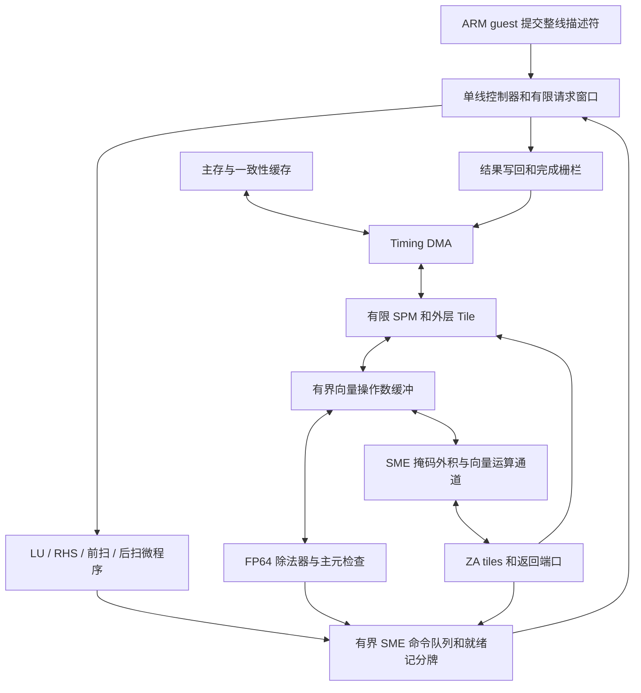

单线 LU-SGS 的 SME/ZA 计算后端框架方案，2026-11-09。

本提案采用用户确认的方向，由现有加速器控制器调度 SME/ZA 计算模块，允许自定义命令接口。推荐沿用单线预变换算法，把 LU、多个 RHS 的三角求解、前扫和后扫的算术工作统一交给一个有界的 SME 后端。方案状态为设计提案，gem5 接入、周期模型和原生性能验收列为实施工作。

原方案作为独立实验基线保留，使用现有 `lusgs-single-line` 入口。新方案建议新增 `lusgs-single-line-sme` 入口和 `--coeff-compute-backend=sme-za` 选择项。两个入口共用原始输入、独立数值参考和结果管理协议，各自记录实际计算资源、源码、参数与二进制身份。

原基线的登记信息如下。

| 项目 | 已核对的值 |
|---|---|
| 当前分支 | `codex/cfd-dsa-upload` |
| HEAD | `6c8a459af2d25f1161e0e9e43a4262799f1c47e7`，运行实现还包含工作树改动 |
| 已安装模型 | R40，当前分场景选型包含 R41/R42 |
| 选型清单 SHA256 | `ad3ac28c3a1c0ff7ef31c88314c0cadaae46b07bdbbc38b1cfc47e80a6f591fc` |
| ARM 二进制 SHA256 | `628b38ad21f39c293ddd9404a5766f269de61c507edf512ca53bf2c8557a5f6a` |
| 指纹范围 | 历史验收快照 252 个文件，当前 253 个文件。差异为 4 个工具文件和新增的流式哈希工具 |

这组身份绑定到已发布的分场景配方。后续 SME 实验使用新的 campaign，并在第一次改动计算实现之前冻结当时工作树的完整受影响源码。[已发布配方](/home/zyy/gem5/results/cfd_dsa/analysis/round42-four-ddr-rf-read64-20261104/selected-recipes-v1.json)

现有仓库提供了两类可利用的基础。标准 SME 路径具备 FP64 FMOPA/FMOPS、ZA 行列搬移和流式状态的代码。Path C 具备五列 partial-sum 流水、自定义指令、ZA 状态管理和 SPM 供给实验。Path C 的实际更新为 `ZA[:,k] = ZA[:,k-1] + A[:,k]*x[k]`，适合提供 MVM 调度和状态验证经验。通用带掩码的二维外积、多个 RHS 面板和完整 LU 生命周期需要在新后端表达。[SME 指令生成器](/home/zyy/gem5/src/arch/arm/isa/insts/sme.isa:564) · [Path C 状态更新](/home/zyy/gem5/src/arch/arm/cfd_local_spm.cc:3042)

可考虑三种计算组织，推荐按表中顺序推进。

| 组织方式 | SME 承担的计算 | 作用与取舍 |
|---|---|---|
| LU 加成块 TRSM，再执行前后扫 | LU trailing update、多 RHS 更新、两个方向的矩阵向量运算 | 首个完整版本。计算边界明确，便于复用现有预变换参考和生命周期 |
| 对 `[D | R | L | U]` 联合消去，再成块回代 | 每个主元生成后，同时更新 D 的尾部和已经到达的 RHS 面板 | 后续融合优化。减少因子搬移，并把 RHS 前代与 LU 重叠 |
| 直接在递推中求解 `D*y = R-L*y_prev` | 每点的矩阵向量乘和三角求解 | 独立算法对照。减少 Lbar/base 预变换工作，同时把三角求解放入逐点反馈链，需要重新评估整轮周期 |

推荐框架由控制器负责依赖和数据生命周期，由 SME 后端负责算术、ZA 数据和真实完成时刻。

CPU 通过命令入口启动计算，SME 后端拥有自己的 ZA 状态和操作数缓冲。复用标准 SME 的运算语义时，需要通过明确的数据接口接入其计算规则。当前 ISA 实现依赖 CPU 的 ExecContext 和架构寄存器，现有 Path C 还包含自定义 MOVA 读取路径，因此接入工作需要明确每份状态的所有者。性能模型由新后端的发射、依赖、端口和完成事件共同决定。[控制器周期入口](/home/zyy/gem5/src/arch/arm/cfd_coeff_preprocess_controller.cc:6695) · [MOVA 自定义读取入口](/home/zyy/gem5/src/arch/arm/cfd_local_spm.cc:3267)

每个单元的 D、L、U 为 5×5 FP64 矩阵，R 为五维向量。为区分网格耦合块和 LU 因子，记 `D_i = ℒ_i 𝒰_i`。整个计算服务仍求解

\[
D_i b_i=R_i,\qquad D_i\bar L_i=L_i,\qquad D_i\bar U_i=U_i,
\]

\[
y_i=b_i-\bar L_i y_{i-1},\qquad
\Delta q_i=y_i-\bar U_i\Delta q_{i+1}.
\]

第一点省略 L 面板，最后一点省略 U 面板，单点只求解 R。后向在最后一个 y 就绪后开始。独立单元的系数预处理可以提前执行，两个方向的递推分别保留相邻单元依赖。

**LU 的矩阵更新天然对应 SME 的外积减法。** 在主元 k 处先计算 `r_k=1/A[k,k]`，缩放得到 `ℓ=A[k+1:,k]*r_k`，再更新

\[
A_{k+1:,k+1:}\leftarrow
A_{k+1:,k+1:}-\ell\,A_{k,k+1:}.
\]

一次掩码外积命令可以描述这个尾部矩阵更新，物理执行再按阵列宽度分拍。每个主元必须等它依赖的 ZA 写入或已计时的转发完成。首版沿用现有无主元交换 LU 及主元有效性检查，复用同一点的五个倒数供 RHS 缩放。

**多个 RHS 在同一个面板中更新，可以复用 LU 因子。** 内部单元构造

\[
B_i=[R_i\mid L_i\mid U_i],\qquad
X_i=D_i^{-1}B_i=[b_i\mid\bar L_i\mid\bar U_i].
\]

这里的实现执行 `ℒ_i Z_i=B_i` 和 `𝒰_i X_i=Z_i` 两个三角求解。内部点有 11 个 RHS，首尾点各有 6 个，单点有 1 个。给定任一 RHS 列集合 J，前代和回代可以写成

\[
B_{k+1:,J}\leftarrow B_{k+1:,J}-\mathcal L_{k+1:,k}B_{k,J},
\]

\[
B_{k,J}\leftarrow r_k B_{k,J},\qquad
B_{:k,J}\leftarrow B_{:k,J}-\mathcal U_{:k,k}B_{k,J}.
\]

每条更新都具备“系数列乘 RHS 行”的外积结构。初始拆分采用关键面板 `[R | L]` 的 5×6 数据和后台 U 的 5×5 数据。R 和 L 各列分别记录到达状态与三角求解进度，同一命令只合并处于同一三角步的就绪列。晚到的列按保留的 LU 因子推进。调度器优先选择关键列，随后将资源提供给后台 U。联合消去版本可在生成 ℓ 后，同时推进 D 的尾部与 RHS 前代。

**前扫和后扫复用同一个 SME 矩阵向量微程序。** 基本版本将 b 或 y 预装到 ZA 的一行，以转置形式执行五次掩码外积减法

\[
Y^T\leftarrow b^T-\sum_{k=0}^{4}y_{prev,k}\bar L[:,k]^T,
\]

\[
Q^T\leftarrow y^T-\sum_{k=0}^{4}q_{next,k}\bar U[:,k]^T.
\]

该形式每步只更新一行中的五个 FP64 元素，适合按行实现的阵列。它对同一累加器有五步真实依赖。后续可将五个乘积分别写入 ZA 的五行，再经过有界向量树归约生成结果。后一版本改变浮点结合顺序，使用独立参考验收，并计入 ZA 行读取、归约发射和最终结果返回。

LU 和多 RHS 能提供二维并行，前后扫则主要受单线反馈延迟约束。因此优先在同一单元的 RHS 之间以及相邻单元的独立预处理之间填充流水。将不同单元放在不同 ZA tile 可明确隔离外积结果。一个外积掩码表示行集合与列集合的笛卡尔积，跨单元打包还需要避免交叉项。

建议首版沿用配置中已有的 512-bit SVL。按 Arm 的 ZA 布局，它对应 4 KiB ZA，可用八个 8×8 FP64 tile 视图。5×5 和 5×6 的有效区域用行列掩码表示。FP64 外积所需的 `FEAT_SME_F64F64` 作为新方案的能力合同记录。[当前向量长度配置](/home/zyy/gem5/projects/cfd_dsa/configs/run_cfd_dsa.py:3233) · [Arm 外积说明](https://developer.arm.com/community/arm-community-blogs/b/architectures-and-processors-blog/posts/arm-scalable-matrix-extension-introduction-p2) · [Arm ZA 布局说明](https://learn.arm.com/insights/sme/)

一个可实施的逻辑分配是

| ZA tile | 使用者 | 内容 |
|---|---|---|
| ZA0.D | 单元上下文 A | D 的 LU 工作区 |
| ZA1.D | 单元上下文 A | R 与 L 的 RHS 面板 |
| ZA2.D | 单元上下文 A | U 的 RHS 面板 |
| ZA3.D | 单元上下文 B | D 的 LU 工作区 |
| ZA4.D | 单元上下文 B | R 与 L 的 RHS 面板 |
| ZA5.D | 单元上下文 B | U 的 RHS 面板 |
| ZA6.D | 前扫或后扫 | 递推累加器或五行乘积 |
| ZA7.D | 调度与归约 | 临时数据或第二个搬运缓冲 |

两个上下文共享一个 SME 引擎。物理 bank、ZA 读写端口及同一元素的依赖由后端仲裁。外层 24-cell Tile 可继续负责主存搬运，内层 ZA tile 负责当前少量单元的算术工作。前扫消费完的 Lbar 与 base 可释放，y 和 Ubar 保存至后扫消费，长线使用既有有限 Tile 的写出和回读协议。warm 配方按系数版本命中已缓存的 LU/Lbar/Ubar，更新 R 后重新求 b。

新引擎建议提供少量通用微操作。

| 微操作 | 行为 | 必须具备的资源约束 |
|---|---|---|
| ZA/向量行列搬移 | SPM、输入缓冲和 ZA 间传输 | 有界传输队列、真实字节数、bank/端口、读写完成 |
| `OUTER_ACC` / `OUTER_SUB` | `ZA[row_mask,col_mask] +=/-= a*bᵀ` | FMA 通道、操作数读取、ZA 累加依赖、写回信用 |
| `VECTOR_MUL` / `VECTOR_ADD` / `VECTOR_SUB` | 缩放、归约和最终合并 | 与 SME 算术通道的明确共享关系及各自数值语义 |
| `RECIP_FP64` | 有界除法器求倒数 | 真实延迟、启动间隔、结果队列及返回端口 |
| `FENCE` / `CANCEL` | 等待所有相关工作完成或排空 | owner、epoch、在途请求、可见写回与槽位回收 |

LU、TRSM 和 MVM 命令由微程序展开成这些操作。每个命令携带 request/cell/epoch、ZA tile、掩码、操作数位置和依赖 token。只有读操作完成且返回信用足够时才接纳发射，返回经过实际端口后发布就绪。取消时按 owner/epoch 丢弃过期算术结果，已接受的内存请求进入排空流程。

初始资源参数用于建立可核验的周期模型。

| 参数 | 建议起点 |
|---|---|
| 逻辑 SVL / ZA | 512 bit / 4096 B |
| 驻留预处理上下文 | 2 个 |
| 操作数寄存器或缓冲 | 有界 32×512 bit，2048 B，并约束可用槽位和端口 |
| SME 执行引擎 | 1 个，首个时序原型每拍最多处理一个八元素行片段 |
| FP64 算术通道 | 8 个共享通道，后续做 16/32/64 通道消融 |
| FMA 结果延迟 / 行片段 II | 暂取 5 / 1 周期，沿用当前 FMA 模型的起点 |
| FP64 除法器 | 1 个，暂取延迟 12、II 4 周期，结果队列深度 2 |
| 命令 FIFO | 16 项，字段和操作数锁存的字节数分别计费 |
| ZA 端口 | 初始每周期最多读一行、写一行，每行 8 个 FP64 |

8×8 描述逻辑 tile 容量，实际 FMA 吞吐由通道数量、行片段发射和端口共同决定。处理一个有效 5×5 外积，在八通道起点上至少需要五个行片段发射机会，之后等待结果返回和写回。后续扩宽引擎时同步扩展或测量端口、锁存及返回容量。表中时延是研究起点，实际硬件频率、面积与时延标定属于后续工作。

统一记录 `SPM 数据 + ZA + 操作数缓冲 + 上下文 + 队列/流水状态` 的片上容量，以及 FMA、除法器和端口数量。旧 scalar/RHS/LU 资源属于原后端，SME 配方中的所有数据更新均关联到新引擎的实际操作完成。输入读取、搬移、输出写回和有限缓冲背压计入同一 sweep 的时间范围。控制器与引擎使用同一组接受与完成事件定义时序。

控制器的仲裁优先满足当前递推反馈，其次推进当前点缺失的 b/Lbar、下一点的 LU 和关键 RHS，再安排后台 Ubar。后台加入有界等待提升，保证长线 Tile 可以完成和回收。上下文 B 利用上下文 A 等待除法、ZA 返回或数据到达的间隙工作。首版可将整块 LU 完成作为 TRSM 的启动门槛，后续依据逐主元就绪 token 引入 LU/RHS 联合更新。

gem5 的接入建议落到以下模块，名称是本提案中的建议。

| 位置 | 职责 |
|---|---|
| `src/arch/arm/cfd_sme_engine.hh/.cc` | SME 操作、ZA/操作数状态、发射、完成、端口及统计 |
| `src/arch/arm/cfd_sme_lusgs_kernels.hh/.cc` | LU、成块 TRSM、两个方向 MVM 的有界微程序状态 |
| 现有 `cfd_coeff_preprocess_controller` | 后端选择、单线依赖、输入就绪、DMA、版本与生命周期 |
| 新单线 SME profile 与配置入口 | 参数约束、完整资源记录、独立实验 target |
| 现有验收工具的新 SME 资源分支 | 数值、存储、递推、私有 LU、数据集、配置审计和摘要 |

现有标准 SME 的 `MatrixOP` 使用通用 FU 描述，FP64 更新生成器中可见分开的 `fplibMul` 和 `fplibAdd` 调用。新后端先明确采用当前 RHS/LU 路径使用的 FP64 fused 更新语义，并给每个返回建立数值记录。引用标准 SME 指令行为时，逐项核对掩码、舍入和浮点控制状态。历史 Path C 的单步延迟和 MOVA helper 状态可作为对照资料。[通用 Matrix FU](/home/zyy/gem5/src/cpu/o3/FuncUnitConfig.py:138) · [当前 FP64 FMA 合同](/home/zyy/gem5/src/arch/arm/cfd_rhs_fma.hh:10)

实施与验收按以下顺序进行。

1. 建立 SME 引擎的基本操作与数据存储模型。验证 FP64 外积、不同掩码、行列搬移、同 tile 依赖、不同 tile 交错和取消排空。每条操作都提供 issue、compute-complete、writeback-complete 记录。
2. 完成单个单元的 5×5 LU 和 1/6/11 RHS 求解。检查每一步实际结果、主元失败处理、剩余掩码及资源上限，加入融合前代的代数对照。
3. 接入整线 cold/warm 前后扫和长线 Tile。覆盖 1、2、17、65、1024、4096 点及 Tile 边界，按原独立参考检查所有 y/Δq，验证版本重建、输出可见性和恢复。
4. 比较统一后端的整轮周期。先测 LU/TRSM 成块化，再单独测联合消去、乘积树归约、上下文和阵列宽度。训练与留出使用明确冻结的策略，记录各阶段重叠及关键路径等待。

评测同时报告 guest ROI、descriptor 到 visible completion 的控制器周期、LU/RHS/前后扫跨度、有效 FP64 更新数、带有效工作条件的发射率、ZA 搬移量和全部片上/外存流量。活跃掩码覆盖率与物理阵列利用率分别记录，资源池的忙碌周期另行报告。全量数值门限沿用原绝对/相对 `1e-10` 判据。浮点计算图一致的调度变体还检查结果摘要一致性。

本轮已在宿主机做了一次数学验证。临时程序使用 FP64 `libm.fma`，对 `[D | R | L | U]` 做联合消去、倒数缩放和面板回代，再执行以 b/y 为初值的逐项 FMA 前后扫。比较对象是已有 CFD5 文件中保存的独立 oracle。8 份输入包括 65/67 点边界、17/128 点 GT01R 派生数据、两份 1024 点及两份 4096 点，共检查 105170 个 y/Δq 标量，mismatches 均为 0。最大误差占原容差的比例约 `2.22e-6`。该检查支持算术重组的可行性，SME 指令语义、资源时序和加速比由上述后续验收确定。

数学验证使用的输入由 `results/cfd_dsa/datasets/current` 中的 boundary65、boundary67、gt01r17、gt01r128 和上述 R42 配方的 train1024、independent1024、validation4096、holdout4096 所指定。GT01R 派生输入的覆盖范围按各自数据来源说明解释。正式实验继续保存输入 SHA、源码快照、二进制身份和完整轨迹。
