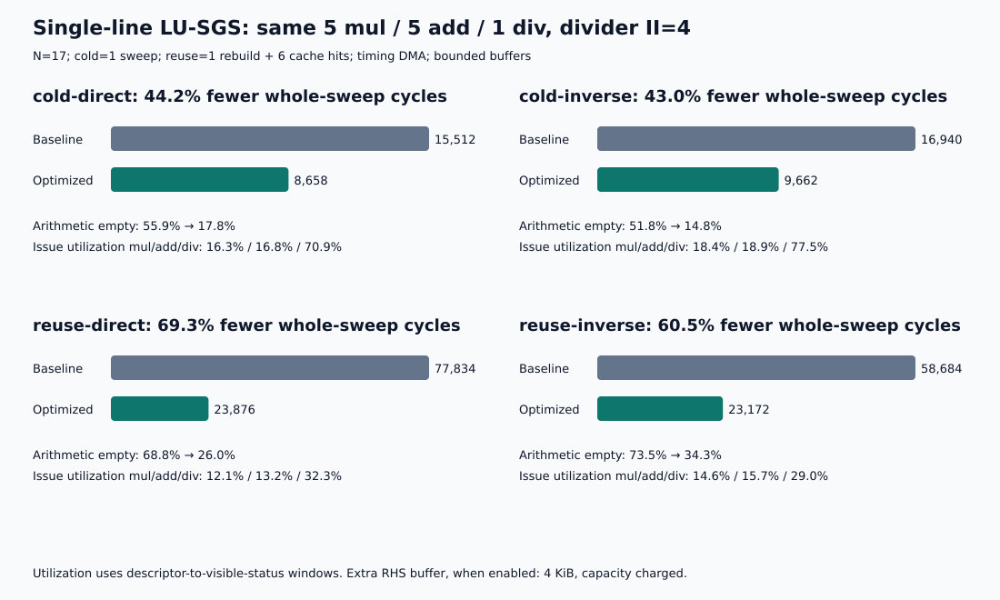

# 优化结果（同一最终二进制）

17 点；cold=一轮，reuse=一次重建后六次复用。主表固定 5/5/1 算术单元与除法 II=4。整轮周期与控制器窗口的利用率分开统计。

| 路径 | 基线周期 | 推荐周期 | 减少 | 加速比 | 算术全空闲 | mul/add/div 发射利用率 | 容量峰值 |
| --- | --- | --- | --- | --- | --- | --- | --- |
| cold-direct | 15512 | 8658 | 44.19% | 1.79× | 55.92% → 17.82% | 16.29%/16.83%/70.86% | 104320B / 196608B |
| cold-inverse | 16940 | 9662 | 42.96% | 1.75× | 51.79% → 14.82% | 18.43%/18.88%/77.50% | 104320B / 196608B |
| reuse-direct | 77834 | 23876 | 69.32% | 3.26× | 68.76% → 25.98% | 12.07%/13.22%/32.31% | 114520B / 196608B |
| reuse-inverse | 58684 | 23172 | 60.51% | 2.53× | 73.48% → 34.26% | 14.56%/15.72%/29.04% | 114520B / 196608B |

## 最终推荐参数

共同参数：opt-level=4、split、rhs-frontier、LU=2、输入槽=2、window=8、双 tile 缓冲、tile DMA 宽度64B、DMA outstanding=16、输出队列深度8；mul/add/div 延迟3/4/12、divider II=4。

| 路径 | row-parallel | tile | solve 上下文 | 实测 case |
| --- | --- | --- | --- | --- |
| cold-direct | 1 | 4 | 2 | cold-direct-r1-t4 |
| cold-inverse | 1 | 4 | 2 | cold-inverse-r1-t4 |
| reuse-direct | 1 | 4 | 4 | reuse-direct-r1-t4-s4 |
| reuse-inverse | 1 | 4 | 2 | reuse-inverse-r1-t4 |

推荐 suite 直接使用这些已测参数。默认 opt-level=0，row-parallel=0 保留原路径。

## 顺序消融

| 阶段 | cold direct | cold inverse | reuse direct | reuse inverse |
| --- | --- | --- | --- | --- |
| l0 | 15512 | 16940 | 77834 | 58684 |
| l1 | 13308 | 14300 | 68976 | 56046 |
| l2 | 8868 | 10452 | 30200 | 52186 |
| l3 | 8868 | 10452 | 28240 | 24536 |
| l4 | 8876 | 10368 | 28732 | 24452 |
| l4rows | 8790 | 10460 | 25184 | 24548 |

l4rows 为 l4 + RHS 行并行（额外4KiB）。此表为2/2上下文、tile4、frontier-aware、输出队列4；推荐配置的变化另列，不把参数收益混入消融。

## 除法 II 与 reciprocal（独立实验）

| 路径 | divide II=4 | divide II=2 | divide II=1 | reciprocal II=4 |
| --- | --- | --- | --- | --- |
| cold-direct | 8790 | 8806 | 8684 | 8800 |
| cold-inverse | 10460 | 8374 | 8296 | 8434 |
| reuse-direct | 25184 | 25204 | 25072 | 25982 |
| reuse-inverse | 24548 | 22464 | 22382 | 22534 |

II=2/1 改变峰值硬件吞吐，并非固定计算能力主表。inverse cold 受益明显；direct 的收益小且有退化。没有综合面积/功耗/频率数据，不据此推荐更高吞吐 divider。

## 局部证据

- l0-cold-direct: 最后一轮控制器 12810 周期；记录 1784B；列 handoff 间隔 {'40': 1, '39': 13, '4531': 1, '3170': 1}；warm 槽/重叠 {}。

- l4rows-cold-direct: 最后一轮控制器 6086 周期；记录 320B；列 handoff 间隔 {'135': 1, '565': 1, '27': 8, '992': 1, '181': 1, '889': 1, '457': 1, '169': 1, '430': 1}；warm 槽/重叠 {}。

- l0-reuse-inverse: 最后一轮控制器 6702 周期；记录 1784B；列 handoff 间隔 {'40': 1, '39': 13, '5590': 1, '3167': 1}；warm 槽/重叠 {}。

- l4-reuse-inverse: 最后一轮控制器 2103 周期；记录 320B；列 handoff 间隔 {'28': 1, '320': 1, '1388': 1, '27': 8, '168': 1, '1725': 1, '284': 1, '1333': 1, '175': 1}；warm 槽/重叠 {'slot_peak': 4, 'rhs_prefetch_pairs': 16, 'write_overlap_pairs': 12}。

详见 [实现与模型边界](../../../../projects/cfd_dsa/docs/CFD_DSA_SINGLE_LINE_OPTIMIZATION_20261012.md)。

